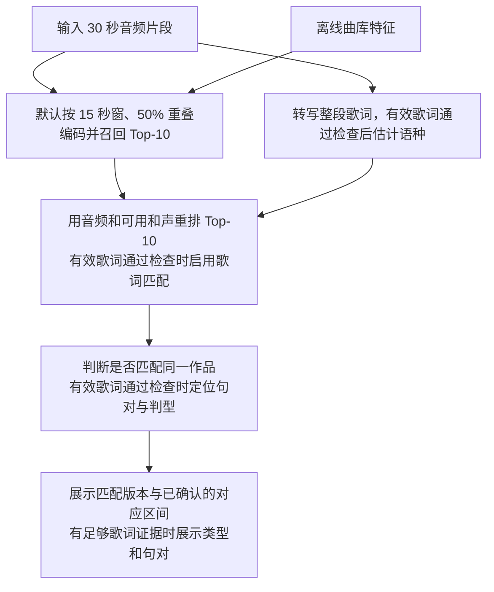

# CARE: Cover Song Alignment and Retrieval from Excerpts

准备材料：讨论帖中发布总结（加上demo链接），报告，poster，demo（本机->html/render托管，录频、截图）

| 模型                                                     | 论文或模型说明                                               | 开源代码                                                     | 预训练权重                                                   |
| -------------------------------------------------------- | ------------------------------------------------------------ | ------------------------------------------------------------ | ------------------------------------------------------------ |
| **CoverHunter**                                          | [CoverHunter 论文](https://arxiv.org/abs/2306.09025)         | [官方 PyTorch 实现](https://github.com/Liu-Feng-deeplearning/CoverHunter) | [作者发布的预训练权重](https://drive.google.com/file/d/1rDZ9CDInpxQUvXRLv87mr-hfDfnV7Y-j/view) |
| **Echora Kiki**                                          | [Kiki 模型卡](https://huggingface.co/hcxlabs/echora-kiki) · [基础模型 MOSS-Transcribe-Diarize 技术报告](https://arxiv.org/abs/2601.01554)。Kiki 自身以模型卡为引用来源。 | [Echora 应用代码](https://github.com/hcx-labs/echora-app) · [MOSS 基础模型推理代码](https://github.com/OpenMOSS/MOSS-Transcribe-Diarize) | [Kiki 歌词转写权重](https://huggingface.co/hcxlabs/echora-kiki) |
| **Beat This! `final0`**                                  | [Beat This! 论文](https://arxiv.org/abs/2407.21658)          | [官方训练与推理代码](https://github.com/CPJKU/beat_this)     | [官方权重目录，选择 final0.ckpt](https://cloud.cp.jku.at/index.php/s/7ik4RrBKTS273gp) |
| **Qwen3-Embedding-0.6B**                                 | [Qwen3 Embedding 技术报告](https://arxiv.org/abs/2506.05176) | [官方代码与推理示例](https://github.com/QwenLM/Qwen3-Embedding) | [0.6B 句向量权重](https://huggingface.co/Qwen/Qwen3-Embedding-0.6B) |
| **MERT-v1-95M**                                          | [MERT 论文](https://arxiv.org/abs/2306.00107)                | [官方训练代码](https://github.com/yizhilll/MERT)             | [v1-95M 权重与推理示例](https://huggingface.co/m-a-p/MERT-v1-95M)，权重采用 CC BY-NC 4.0。 |
| **Qwen3-ASR-1.7B ＋ Qwen3-ForcedAligner-0.6B**           | [Qwen3-ASR 技术报告](https://arxiv.org/abs/2601.21337)，涵盖转写模型和强制对齐模型。 | [官方代码与时间戳推理示例](https://github.com/QwenLM/Qwen3-ASR) | [ASR-1.7B 转写权重](https://huggingface.co/Qwen/Qwen3-ASR-1.7B) · [ForcedAligner-0.6B 对齐权重](https://huggingface.co/Qwen/Qwen3-ForcedAligner-0.6B) |
| **Unified Music Identification for Tracks and Versions** | [论文](https://arxiv.org/abs/2608.19919)                     | [官方训练与推理代码](https://github.com/raraz15/unified-track-and-version-id) | [官方 Zenodo 权重与配置](https://zenodo.org/records/22016080) |
| **ByteCover3（文献参照）**                               | [ByteCover3 论文](https://arxiv.org/abs/2303.11692)          | 暂未核实到作者发布的 ByteCover3 原版代码。                   | 暂未核实到官方预训练权重。                                   |

---

**Encoder:**

CoverHunter [论文](https://arxiv.org/abs/2306.09025) · [代码](https://github.com/Liu-Feng-deeplearning/CoverHunter) · [权重](https://drive.google.com/file/d/1rDZ9CDInpxQUvXRLv87mr-hfDfnV7Y-j/view)

**Transcriber:**

Echora Kiki [模型卡与权重](https://huggingface.co/hcxlabs/echora-kiki) · [Echora 应用代码](https://github.com/hcx-labs/echora-app) · [MOSS 基础模型报告](https://arxiv.org/abs/2601.01554) · [MOSS 推理代码](https://github.com/OpenMOSS/MOSS-Transcribe-Diarize)

**声学特征提取：**

Beat This! `final0` [论文](https://arxiv.org/abs/2407.21658) · [代码](https://github.com/CPJKU/beat_this) · [final0 权重](https://cloud.cp.jku.at/index.php/s/7ik4RrBKTS273gp)

**算法：**

| 环节 | 算法 | 作用 |
|---|---|---|
| **音频向量召回** | **余弦相似度＋Top-10 近邻搜索** | 用同一编码器分别编码 30 秒查询片段内和曲库整曲上的滑动窗口，默认窗长 15 秒、重叠率 50%（步长 7.5 秒），做 L2 归一化后计算点积。第一版取每首录音与查询之间的最高窗口对相似度，按录音返回 Top-10，并保留命中窗口的时间。Covers80 [数据集](https://www.ee.columbia.edu/~dpwe/LabROSA/projects/coversongs/covers80/) 直接做精确搜索。[相似项搜索课件](</E:/AI4Titi/0.0.2_DataMining/FinalProject/slides/similar.pdf>) |
| **同语言歌词匹配** | **字符或词的 k-shingles＋Jaccard** | 把每句歌词拆成相邻片段，例如“等你回来”的字符二元组是 `{等你, 你回, 回来}`。用交集大小除以并集大小，给查询句和候选句打分。中文可先用字符二元组，英文用词二元组。按句或相邻几句比较，能避免整首歌词太长，把短查询的重合度稀释。对应课件第 8–12、18 页。[Shingling 与 Jaccard 课件](</E:/AI4Titi/0.0.2_DataMining/FinalProject/slides/similar.pdf>)在音乐已对齐的多个乐句上聚合词面重合度，作为区分原词翻唱与同语种重新填词的主要文本证据。 |
| **跨语言歌词匹配** | **多语言句向量余弦＋Smith–Waterman 局部对齐** | 用 Qwen3-Embedding-0.6B [技术报告](https://arxiv.org/abs/2506.05176) · [代码](https://github.com/QwenLM/Qwen3-Embedding) · [权重](https://huggingface.co/Qwen/Qwen3-Embedding-0.6B) 编码每句原语言歌词，得到“查询句 × 候选句”的相似度矩阵。再用动态规划找得分最高的有序片段，允许漏一句或多唱一句。高语义相似度可辅助候选重排和句对定位，也可用于分析同语种改写。不同语种翻唱的主标签由演唱语种决定，译唱和重新填词均可归入此类。局部对齐是对课内序列距离知识的扩展。[局部对齐原论文](https://pubmed.ncbi.nlm.nih.gov/7265238/) |

**评测：**

数据集：（构建benchmark进行评测）
Covers80 [https://www.ee.columbia.edu/~dpwe/LabROSA/projects/coversongs/covers80/](https://www.ee.columbia.edu/~dpwe/LabROSA/projects/coversongs/covers80/)

JamendoLyrics [数据与逐行标注](https://huggingface.co/datasets/jamendolyrics/jamendolyrics)

| 数据集            | 查询和曲库怎么构造                                           | 评测什么                                                     |
| ----------------- | ------------------------------------------------------------ | ------------------------------------------------------------ |
| **Covers80** [数据集](https://www.ee.columbia.edu/~dpwe/LabROSA/projects/coversongs/covers80/) · [原始 A/B 评测协议](https://labrosa.ee.columbia.edu/~dpwe/pubs/EllisC07-covers.pdf) | 每首作品有 A、B 两版。按官方 A/B 列表，为 80 首 A 版各记录一个随机起点，推理时从原录音读取对应的 30 秒，建立由 80 首 B 版整曲组成的曲库。每个查询有 **1 个正确答案、79 个干扰项**。 | **主评测。** 检验完整流水线能不能提高短片段翻唱检索的排名。 |
| **JamendoLyrics** [数据与逐行标注](https://huggingface.co/datasets/jamendolyrics/jamendolyrics) | 将音频送给 Echora Kiki [模型卡与权重](https://huggingface.co/hcxlabs/echora-kiki) 和 Qwen 转写流水线 [转写权重](https://huggingface.co/Qwen/Qwen3-ASR-1.7B) · [对齐权重](https://huggingface.co/Qwen/Qwen3-ForcedAligner-0.6B)，逐行歌词和起止时间留作评分。 | **时间戳模块评测。** 报告找回了多少行，以及匹配成功的行平均早了或晚了多少。 |

给一段 30 秒的录音，从整曲曲库里找出同一作品的其他演绎版本。

对每个确认的版本对，CARE 还要回答两个问题：两个版本的歌词属于哪种关系，以及当前唱到的乐句在另一版本中对应哪一句。输出包含作品与录音 ID、翻唱类型及其证据、两侧歌词行和可播放的起止时间。类型属于一对录音，分为原词翻唱、同语种重新填词和不同语种翻唱。

**正式检索基线**

正式跑分选两条公开权重的检索基线，分别比较通用音乐表征和专门学习翻唱关系的模型。

| 检索基线 | 30 秒查询如何处理 | 可以回答的问题 |
|---|---|---|
| **MERT-v1-95M** [论文](https://arxiv.org/abs/2306.00107) · [代码](https://github.com/yizhilll/MERT) · [权重与推理示例](https://huggingface.co/m-a-p/MERT-v1-95M) ＋滑窗余弦 | 冻结编码器，把音频重采样到 24 kHz，对每个滑窗取最后一层有效帧的均值并做 L2 归一化。查询和参考录音按相同设置滑窗，每首歌取最高窗口对余弦分。模型发布了逐帧特征提取接口，预训练上下文为 5 秒。 | 单靠通用音乐向量，30 秒查询能找回多少同作品录音？ |
| **Unified Music Identification for Tracks and Versions** [论文](https://arxiv.org/abs/2608.19919) · [推理代码](https://github.com/raraz15/unified-track-and-version-id#quickstart-extracting-embedding) · [权重](https://zenodo.org/records/22016080) | 用官方版本识别模型处理 16 kHz 单声道音频。对查询和曲库使用相同的滑窗设置，比较窗口向量，按录音取最高窗口对余弦分。官方接口支持变长输入，训练窗长为 20 秒。原论文的版本识别评测使用整曲，本项目评测 30 秒查询。 | 和专门学习不同演绎版本相似性的模型相比，CARE 的歌词与和声证据能增加多少命中？ |

两条基线与 CARE 共用曲库、查询起点和正确版本标签，查询侧按共用清单从原录音读取起点后的 30 秒。两条基线和 CARE 的音频检索默认均用 15 秒窗、50% 重叠，报告 30 秒查询的 Hit@1、Hit@5 和 MRR@10。JamendoLyrics [数据与逐行标注](https://huggingface.co/datasets/jamendolyrics/jamendolyrics) 继续用于逐句时间戳评测。

---

| 流水线               | 输入音频                                                     | 音频编码                                                     | 带时间戳的歌词转写                                           | 为什么选这组                                                 |
| -------------------- | ------------------------------------------------------------ | ------------------------------------------------------------ | ------------------------------------------------------------ | ------------------------------------------------------------ |
| **① 翻唱识别原型** | **Covers80** [数据集](https://www.ee.columbia.edu/~dpwe/LabROSA/projects/coversongs/covers80/)，80 首作品，每首两个演唱版本，有整曲音频 | **CoverHunter** [论文](https://arxiv.org/abs/2306.09025) · [代码](https://github.com/Liu-Feng-deeplearning/CoverHunter) · [权重](https://drive.google.com/file/d/1rDZ9CDInpxQUvXRLv87mr-hfDfnV7Y-j/view)，按官方流程从音频提取 CQT，再生成翻唱识别向量 | **Echora Kiki** [模型卡与权重](https://huggingface.co/hcxlabs/echora-kiki) 直接从歌曲生成每行歌词及近似起止时间 | CoverHunter 官方就提供 Covers80 示例，公开权重的训练集也排除了 Covers80。数据和编码器衔接最省事，歌词分支无需人工提供文本。 |
| **② 验证逐句时间戳** | **JamendoLyrics** [数据与逐行标注](https://huggingface.co/datasets/jamendolyrics/jamendolyrics)，有歌曲音频，以及可留作评测的逐行歌词和起止时间 | **MERT-v1-95M** [论文](https://arxiv.org/abs/2306.00107) · [代码](https://github.com/yizhilll/MERT) · [权重与推理示例](https://huggingface.co/m-a-p/MERT-v1-95M)，以 24 kHz 输入，输出约每秒 75 帧的音乐特征；按预测的句子时间范围取平均，即可得到每句对应的音乐向量 | **Qwen3-ASR-1.7B** [技术报告](https://arxiv.org/abs/2601.21337) · [代码](https://github.com/QwenLM/Qwen3-ASR) · [转写权重](https://huggingface.co/Qwen/Qwen3-ASR-1.7B) 先转写原语言歌词，**Qwen3-ForcedAligner-0.6B** [对齐权重](https://huggingface.co/Qwen/Qwen3-ForcedAligner-0.6B) 再对齐词边界，按停顿分句后取首词开始、末词结束 | 这一组能实际量出“每句早了或晚了多少”。Qwen 的 ASR 有带伴奏歌曲的评测，而对齐器官方列出的适用音频是语音，正好可以用 JamendoLyrics 检验它在歌声上的误差。 |

---

# Novelty

1. 和声加权对齐

   先用 CoverHunter [代码](https://github.com/Liu-Feng-deeplearning/CoverHunter) 召回候选，再用按节拍提取的 chroma 特征，把查询和候选里可能对应的乐句对齐。加权的做法类似文本检索里的 IDF：统计每种短和声模式出现在多少首参考歌曲里。**很多首歌都出现的模式，即使对齐得很好，也只加少量分。罕见且能连续对齐的模式，贡献更大。** 频率按作品计，同一首歌反复出现的副歌只计一次。

2. 按证据分别作答

   系统处理完整的 30 秒查询，检查第一名是否明显领先第二名，以及是否有足够长、连续的乐句与查询对齐。歌曲、翻唱类型和歌词句对可以分别作答。查询有足够有效歌词且两侧演唱语种已可靠确认时，若语种不同，可以直接报不同语种翻唱。同语种片段如果只听到一个重复乐句，可以报歌曲，并将类型标为「待确认」。

3. **翻唱类型识别。** 在音乐已确认属于同一作品的前提下，判断两个演唱版本的歌词关系。覆盖以下三类。

   | 类型 | 人工判定依据 | 系统使用的证据 |
   |---|---|---|
   | 原词翻唱 | 两版主要演唱语种相同，并沿用同一套歌词，允许少量改字、衬词和重复次数变化。 | 多个可靠的对应乐句有较高的词面重合度。 |
   | 同语种重新填词 | 两版主要演唱语种相同，多个对应乐句有实质性重写，可以保留相近的主题或意思。 | 音乐对齐稳定，两侧转写可靠，多个对应乐句的措辞有持续差异。 |
   | 不同语种翻唱 | 两版主要演唱语种不同，涵盖直译、意译、部分翻译和完全重新填词。 | 已确认属于同一作品，两侧的演唱语种均可可靠识别且不同。 |

   查询侧未识别到歌词、仅有衬词或有效演唱过短时，跳过判型。通过有效歌词判断后，若主要语种因混语等原因仍不明确，或同语种分支缺少可靠句对，则标为「类型待确认」。人工标注整曲关系时，听读多个段落确认两版的主要演唱语种。有明确主要语种的少量混语，按主要语种判定。主要语种仍无法确定的双语版本登记为混语样本。短片段的判断标明证据区间，重复副歌只计一份证据。

4. **跨版本歌词行对应。** 句对表示“在同一音乐位置唱出的歌词”，三类都可展示。由音乐路径先提出句对，再用时间重叠和句序筛选。文本相似度可辅助挑选备选行。对同语种或不同语种的重填版本，仍可凭音乐路径定位可试听的对应乐句。

5. 输出了对应区间（定位区间）

---

# 完整流程

30 秒片段输入 → 用滑窗音频向量从曲库召回 10 条候选录音 → 用音频相似度和可用的加权和声证据重排，有效歌词通过检查后估计语种并加入可用的歌词匹配 → 判断是否匹配同一作品 → 确认同一作品且有足够有效歌词时，再定位句对与判型（复用语种结果，同语种再比原词）→ 展示已确认结果

1. **离线建库。** Covers80 [数据集](https://www.ee.columbia.edu/~dpwe/LabROSA/projects/coversongs/covers80/) 用 CoverHunter [代码](https://github.com/Liu-Feng-deeplearning/CoverHunter)。同一套实验的查询和曲库共用编码器，窗口向量记录所属录音和起止秒数。Echora Kiki [模型卡与权重](https://huggingface.co/hcxlabs/echora-kiki) 生成逐行歌词及时间戳，Qwen3-Embedding-0.6B [权重](https://huggingface.co/Qwen/Qwen3-Embedding-0.6B) 编码每行文本。Beat This! [代码](https://github.com/CPJKU/beat_this) 给出拍点，将相邻拍点间的 12 维 chroma 取平均，得到每拍的音高分布。 对参考录音中清理后的有效歌词提前缓存 fastText 主要语种、首选和次选得分，并保留分段语种以检查混语。
2. **召回候选录音。** 推理时按清单从原录音读取起点至起点后 30 秒。查询侧将整个片段一次送入 Echora Kiki 转写，保留片内逐行时间戳。音频检索在该片段与参考整曲上分别滑窗，默认窗长 15 秒、步长 7.5 秒。30 秒查询产生 3 个窗，起点分别为 0、7.5、15 秒。对任意窗长和重叠率，先按步长生成完整窗，若末尾尚未覆盖，再补一个与音频末端对齐的完整窗并去重。两侧使用相同规则，保存真实起止秒数。计算查询窗与参考窗归一化向量的点积，每条参考录音取最高窗口对得分，保留前 10 条录音及命中窗口对的两侧时间。Covers80 [数据集](https://www.ee.columbia.edu/~dpwe/LabROSA/projects/coversongs/covers80/) 用精确余弦搜索。
   **检查查询是否有足够有效歌词。** 在整段转写后、候选重排前，对每条 30 秒查询执行一次检查。所有 Top-10 候选共用该结果。

   - 清除空行、纯标点、`[Music]` 等非歌词标记及时间戳无效的行。清理后为空，记录「未识别到歌词」。
   - 用多语衬词表和重复音节规则识别 `oh oh oh`、`la-la-la`、`啊啊啊` 等。整行仅由衬词组成时丢弃，衬词与实际歌词混合时保留实际歌词。清理后有文本、但各行均为衬词时，记录「仅衬词」。
   - 用 Demucs 分离人声，结合人声轨的短时能量及其相对混音的能量占比，估计人声活动区间。在人工试听的演唱与伴奏样本上校准检测门槛。将剩余歌词行的时间区间与人声活动区间取交集，合并重叠区间后累计时长。第一版试用**累计至少 3 秒，且至少有一条可辨认的有义短语**作为启用条件。没有声学证据支持歌词时，记录「未识别到歌词」。有人声支持但片段过短或只剩零碎词时，记录「有效演唱过短」。歌词时间戳为近似值，纯伴奏也可能触发误转写。[Echora Kiki 模型说明](https://huggingface.co/hcxlabs/echora-kiki) · [Demucs 官方实现](https://github.com/facebookresearch/demucs)

   **有义短语与语种。** 去掉衬词后，同一短语内空格分词语言至少有 2 个词，中文至少有 4 个汉字，作为第一版粗筛。其他书写系统采用对应分词规则，由能理解该语种的标注者抽听核验。验证集对照人工试听标签比较累计时长 2、3、5 秒，分别记录误开、误关的次数与比例，另列喊词、拖音和混语。通过检查后、重排前，用 fastText `lid.176.bin` 对当前查询有效文本取前两种语言。首选得分 ≥ 0.80 且领先 ≥ 0.20 时暂认定可靠，在短歌词和混语验证样本上校准。两侧语种均可靠且相同时启用词面分支，其余有可靠文本的情形用多语言句向量。语种不稳时允许音乐匹配和语义重排，类型待确认。[fastText 语种识别](https://fasttext.cc/docs/en/language-identification.html)

3. **在候选中找对应乐句。** 整段歌词和逐拍和声分别产生路径，并保留每个匹配单元两侧的秒数。

   **歌词。** 仅使用有效歌词。令句对分数 `s` 为映射到 [0,1] 的句向量余弦（即 `(1+cos)/2`），可靠同语种时取它与 shingles Jaccard 的等权平均。用验证集中不同作品的句对，按同语种融合、仅语义两种方式分别求第 95 百分位 `b`。Smith–Waterman 采用 `L[i,j]=max(0, L[i-1,j-1]+s-b, L[i-1,j]-0.15, L[i,j-1]-0.15)`，第 0 行、第 0 列置零。从峰值回溯到零，取最高累计分除以查询有效行数作为原始歌词分。查询未通过有效歌词检查或参考无有效行时，将该分支记为缺失。记录实际匹配行、行序、句间距与时长，可供区间校准。仅有一次通用短句重合时，由覆盖率和区间置信度限制其定位作用。

   **和声模式。** 用相邻拍点之间的 12 维平均 chroma，逐拍 L2 归一化。仅为统计 IDF，把步长为 1 拍的四拍窗口量化为 `(0,(p₂−p₁) mod 12,(p₃−p₁) mod 12,(p₄−p₁) mod 12)`，其中 `p` 为该拍最强音级。零能量或最强音级并列时该窗不提供稀有度加权。设参考库含 N 部作品，df 为出现过该模式的作品数，同作品的不同录音和重复乐句合计一次。两侧模式相同时取 `w=1+2·log((N+1)/(df+1))/log(N+1)`，其余取 1，权重范围为 [1,3]。

   **和声路径与归一化。** 对 Top-10 中每条完整候选录音分别尝试 12 个固定移调量 r。用完整逐拍向量计算代价 `c(i,j)=1−cos(qᵢ,rotate(hⱼ,r))`，无效拍代价取 1。子序列 DTW 允许从候选任一拍起步，递推为 `D[i,j]=c(i,j)+min(D[i−1,j−1], D[i−1,j]+0.15, D[i,j−1]+0.15)`，设 `D[0,j]=0`、`D[i,0]=∞ (i>0)`。水平步和垂直步各自最多连续一次，实现时分别保存末步方向的状态，递推只比较允许的前驱。每种移调从查询末行的局部极小值回溯，按总代价从低到高保留最佳路径和异地备选。并列优先对角步，再按候选起点和移调编号从小到大选择。路径搜索使用未加权代价，保证加权消融可以复用同一条路径。[子序列 DTW 接口](https://librosa.org/doc/0.11.0/generated/librosa.sequence.dtw.html)

   对最低代价路径，每个查询拍 i 只计一次，若对应多个候选拍，取代价最低者（并列取最早）。两侧分别取以匹配拍结尾的四拍模式，开头不足四拍时权重取 1。设查询有 B 个完整拍区间，原始和声分为 `H_raw=Σᵢ wᵢ·(1−cᵢ)/(3B)`，范围为 [0,1]。任一侧不足四个有效连续拍时，和声分支记为缺失。另用验证集确定可靠拍的最低余弦，实际时间轴上最长连续可靠拍段的时长除以 30 秒，作为连续覆盖率。
4. **融合分数并作答。** 在每轮开发作品内按分支拟合单调校准函数，将原始音频、和声、歌词分映射为 [0,1] 内的 A、H、L。默认基础分取 `0.7A+0.3H`，和声缺失时取 A。通过有效歌词检查且有正分匹配路径时，额外加 `0.15L`，其余加 0，故排序总分最高为 1.15。确认歌曲要求首名总分和领先第二名的分差均达门槛。有可靠和声时，连续覆盖率初值为 0.50，即至少 15 秒。对有和声与仅音频等证据组合分别校准确认门槛，用库外验证查询筛选误报率 ≤ 5% 的组合，再选库内正确确认数最多者。未达到目标时报告实际误报率及覆盖率。歌曲确认、整段定位、句对展示分别记录状态。

   **E2 整段区间。** 在首名录音上为整个查询 [0,30) 提出以下区间，均以参考录音起点为零。音频最高分窗口对的查询、参考起点分别为 u、v，按单位速度提出起点 `v−u`，将其限制到 `[0,参考时长−30]` 后取完整 30 秒（参考不足 30 秒时取全段）。和声路径取首尾可靠拍边界，歌词路径取首尾完整匹配句边界，得到两对严格递增的锚点 (q₁,c₁)、(q₂,c₂)。用 `a=(c₂−c₁)/(q₂−q₁)` 提出 `[c₁−a·q₁, c₂+a·(30−q₂))` 并裁到录音边界。初值要求锚点跨度至少 15 秒、每侧外推不超过 7.5 秒。无足够锚点、超限或空区间时丢弃。歌词和和声各保留最多 3 处，按原路径质量排序，同分支 IoU ≥ 0.8 的去重。残句的裁切端不能用作锚点。

   **E2 唯一输出与冲突。** 三个来源各用带人工区间的验证作品估计 `p=P(与任一合理标注的 IoU≥0.5 | 录音正确)`。可用逻辑回归，输入该来源匹配分、覆盖率、外推量，音频使用窗口相似度与该窗口占查询的比例。默认保留 p ≥ 0.60 的候选。若不同来源有 IoU ≥ 0.5 的一致区间对，按两者较低 p 最大、较高 p 最大的顺序选一对，输出其中 p 较高的原区间。若各位置互相冲突，选最高 p，要求它比所有与它 IoU < 0.5 的备选至少高 0.15。仅一处可信位置时直接输出。仅音频可信时可按同一门槛回退到音频提出的整段。均不可信或冲突未解时标记「区间待确认」，已确认的歌曲仍可报告。并列优先靠近音频预测中心、再取较早起点与终点。区间门槛在验证集冻结，测试标注只用于评分。
5. **从时间戳生成句对。** 每行保存 `recording_id、line_id、text、start_sec、end_sec、language、language_confidence`。查询时间以切片起点为零，另存原录音偏移。在已确认的整段区间附近复用第 3 步保存的逐拍 chroma 路径，保留可靠对齐块中的拍点秒数对，按查询时间单调插值得到映射 `f(t)`。查询通过有效歌词检查后，对查询行 `[s,e]`，将 `[f(s),f(e)]` 与候选行比较区间 IoU，同时检查路径覆盖率与前后句序。允许一行对应相邻两行以及反向拆句，将相邻行合成一个比较区间。展示初值要求映射区间 IoU ≥ 0.50，且比次佳不同位置的 IoU 高至少 0.10。仅有一个候选位置时直接检查绝对门槛。查询切断歌词时标记残句；落在路径外的边界不作外推。重复副歌出现并列解时记录可接受区间，定位含糊时暂缓高亮。[子序列 DTW 与路径回溯](https://librosa.org/doc/0.11.0/generated/librosa.sequence.dtw.html)
6. **先判语种，再判是否保留原词。** 确认同一作品且查询通过有效歌词检查后，复用重排前得到的查询语种与参考侧缓存，并检查两侧可信度。查询未通过检查时，跳过语种推断和三分类。查询侧只用当前 30 秒片段，参考侧可用曲库缓存的歌词。两侧主要演唱语种可靠且不同时，输出「不同语种翻唱」。语种相同时，在音乐已对齐的多个可靠、非重复句对上计算字词 Jaccard，聚合分数中位数和高重合句比例。至少需要 2 个通过展示门槛且内容不重复的句对。初值要求所有入选句对的 Jaccard 均 ≥ 0.65 才判为「原词翻唱」，均 ≤ 0.25 且两侧转写经质量检查可靠时才判为「同语种重新填词」。中间分数或高低混杂时标为「类型待确认」。语义相近的改写也可归入后者。用验证作品标定阈值，测试时只用系统识别的语言。查询已通过有效歌词检查但后续判型证据不足时，标为「类型待确认」。
7. **展示。** 对确认的配对显示歌曲与可靠的音乐对应区间。查询未通过有效歌词检查时，接口省略 `cover_type`，界面省略翻唱类型与歌词句对，可按原因显示「有效歌词不足，已按音乐匹配」等提示。查询通过检查后，类型和句对各自按证据展示。两栏以「对应乐句」为名展示各自文本和起止时间，点击「依次试听」播放两侧对应区间。可以展示可靠句对并将类型标为「待确认」，也可以在定位含糊时只报歌曲。

# 实验
1. 两个数据集上进行评测

   | 数据集 | 执行方式 | 记录指标 |
   |---|---|---|
   | Covers80 [数据集](https://www.ee.columbia.edu/~dpwe/LabROSA/projects/coversongs/covers80/) | 80 首 B 版整曲建库。使用随机种子 42，按官方 A 版清单顺序为每首录音随机抽取一个起点。若录音时长为 `T` 秒，起点范围为 `[0, T - 30]`，共 80 条查询。清单记录作品 ID、录音 ID、切片起点及划分。各外层折冻结参数后，CARE 和基线使用同一清单中该折的测试查询，保留前奏、间奏和空转写样本。 | 报告召回 Hit@10、重排 Hit@1、Hit@5 和 MRR@10。正确版本未进前 10 时，倒数排名记 0。 |
   | JamendoLyrics [数据与逐行标注](https://huggingface.co/datasets/jamendolyrics/jamendolyrics) | Echora Kiki [模型卡与权重](https://huggingface.co/hcxlabs/echora-kiki) 与 Qwen3-ASR [转写权重](https://huggingface.co/Qwen/Qwen3-ASR-1.7B)＋ForcedAligner [对齐权重](https://huggingface.co/Qwen/Qwen3-ForcedAligner-0.6B) 处理同一批音频，用文本和句序与人工歌词行一对一匹配。MERT [权重与推理示例](https://huggingface.co/m-a-p/MERT-v1-95M) 按预测区间汇聚音乐特征。 | 报歌词行召回率、匹配行的起点和终点平均绝对误差，以及全部参考行中两端误差均在 0.5 秒以内的比例。漏行计入最后一项的分母。 |

   所有融合权重、缺失证据处理规则和作答阈值在与测试作品互斥的验证集上确定。

   **Covers80 验证与主测试。** 用种子 42 将 80 部作品分成 5 个外层折，每折 16 部。同一作品的 A/B 版、歌词句对和人工区间标注始终同折。每轮留出 16 部作测试，其余 64 部作开发。开发集再按作品分为 4 折，每次用 48 部估计负句对分位数、分数及区间置信度校准器，用另外 16 部产生验证预测。汇总内层留出预测，选滑窗、歌词启用、首名确认、E2 和判型阈值。内层仅使用这 64 部作品的 B 版作验证曲库，拟合校准器时仅使用相应 48 部作品的数据。为 E2 开发与测试分别提供完整 30 秒对应区间标注。

   每个外层折选定配置后，用该轮 64 部开发作品重拟合校准器并冻结参数，再将留出的 16 条 A 版查询与完整的 80 首 B 版曲库比较，每条查询都有 1 个正例、79 个干扰项。合并五轮折外预测报告 80 条查询的指标，附各折所选配置。估计库外误报时，另对每个验证或测试查询临时从相应曲库移除该作品的全部参考录音，重新召回和作答。验证误报用于选门槛，测试误报单独计分，并报告误报数与库外查询数。JamendoLyrics 专用于单版本歌词时间戳评测。

   **判型与句对展示。** 在 Covers80 上先给系统正确版本对。用 30 秒查询报告三分类 Macro-F1、各类召回率和混淆矩阵。对有三分类真值的样本，将「待确认」和因有效歌词不足而跳过判型计入真实类别的漏判，并在混淆矩阵中分别记录。另报判型覆盖率、已判型样本准确率、同／不同语种判断准确率，以及给定正确的同语种版本对时区分原词与重填的准确率。句对按三类报告展示覆盖率、已展示句对的正确率和与可接受区间的 IoU。记录语种判错、同语种原词与重填混淆、错选重复副歌的次数。

2. 对比baseline

   **Covers80 检索对比。** MERT 和 Unified Music Identification 两条检索基线使用相同的外层测试查询和完整参考曲库，各自独立返回排名。与 CARE 对比 Hit@1、Hit@5 和 MRR@10。CARE 编码器的纯音频排名列入第 3 项消融，用来衡量重排的贡献。

   **Covers80 匹配区间对比。** 三种方法均为每条查询输出首名歌曲和参考区间。MERT 和 Unified 用首名的最佳窗口对推算参考区间，CARE 复用无拒答门槛评测的 E2 区间。按全部查询报告歌曲和区间同时命中的比例，再在首名均正确的共同查询上比较区间命中和平均 IoU。

   **CARE 端到端计分。** 从完整曲库检索，以所有有三分类真值的查询为分母，报告「首名是同一作品且判型正确」的比例。首名命中时，按实际命中的版本对取类型真值。

   **JamendoLyrics 时间戳对比。** 用第 1 点的歌词行和时间戳指标比较 Echora Kiki 与 Qwen3-ASR＋ForcedAligner。

3. 消融：各个模块去掉后还有没有用

   固定每条查询的 Top-10 候选，比较纯音频、完整系统，以及分别去掉词面匹配、跨语言语义、歌词时间约束和和声分支后的排名。另做一组配对实验，固定拍点、chroma、移调量和已回溯的具体路径，仅将每拍权重设为 1 后重新计分。两组使用相同的验证划分和校准方法分别标定和声分数，避免整体分值缩小直接改变融合权重。逐项报告相对完整系统的 Hit@1 变化，并在有可靠类型标签的样本上分三类统计。固定正确版本对，再分别检查词面匹配对同语种判型的贡献，以及跨语言语义对不同语种句对定位的贡献。回听排名上升和下降的例子。

4. **滑窗参数与检索效率。** 输入始终是 30 秒，待选内部窗长为 10、15、20 秒，分别交叉 25%、50%、75% 重叠。默认 15 秒、50% 重叠能在查询中形成 3 个覆盖整段查询的窗口，相邻窗共享 7.5 秒。10 秒窗用于检验较细的定位粒度，20 秒窗与 Unified 的训练上下文一致。先对 CoverHunter、MERT、Unified 逐一打印各窗长的输入采样点、有效特征帧数、补齐量、向量维数、前 8 个分量、范数及有限值检查，确认不同音频得到可区分的向量，再在验证集跑 9 组配置。每组共用查询、参考录音与整段转写，报告各编码器的召回 Hit@10、最终 Hit@1 及耗时。共用主配置按三个正式编码器验证 Hit@10 的均值选取，并列优先较低耗时。记录每轮内层验证选定的窗长、重叠率及步长，再对该轮外层留出作品测试。[Unified 推理设置](https://github.com/raraz15/unified-track-and-version-id#quickstart-extracting-embedding)

# 与数据挖掘的关系

| 课程知识 | CARE 中的具体操作 | 可以检验的问题 |
|---|---|---|
| 高维相似项搜索与余弦距离 | 将音频窗口视为高维点，用精确余弦搜索召回相似录音。 | 音频相似度能把多少正确版本召回前 10？ |
| Shingling 与 Jaccard | 将同语言歌词的局部字串或词串变成集合，按交集与并集的大小比较。可视化共同的 shingles，解释某句为何命中。 | 转写错一个词后，还有哪些局部片段能匹配？ |
| 模式频率与逆文档频率 | 将作品视作文档、短和声模式视作词项，按包含该模式的作品数加权。一首歌重复多次的副歌只给文档频率贡献一次。 | 降低常见和声的分数后，能否排除和弦相似的其他作品？ |
| 版本关系的分层分类 | 先判语种关系，再在同语种分支聚合多个音乐对齐句对的词面特征。在留出作品上按阶段评测并做特征消融。 | 语种识别在哪些片段上容易出错？词面特征能否区分同语种的原词翻唱与重新填词？ |
| 序列相似性与排序评测 | 从单句相似度扩展到局部有序匹配，用动态规划处理跳句，再用 Hit@K、MRR 和消融实验检验排序。 | 偶然相似的一句歌词和连续对应的多句歌词，能否得到不同排名？ |

课程中可直接对应的是《Finding Similar Items》的 shingles（第 8–12 页）、Jaccard 与 MinHash（第 18–27 页）、余弦距离（第 54–57 页）。将作品级 IDF 用于和声局部对齐、将相对时间用于歌词对齐，是本项目在这些知识上的应用与扩展。[相似项搜索课件](../slides/similar.pdf)

---

| 实验 | 冻结配置结果 |
| --- | --- |
| **三种纯音频检索基线** | 统一使用 CoverHunter 选出的逐折滑窗。Unified 的 Hit@1／Hit@10 为 **74/80／76/80**，CoverHunter 为 **62/80／70/80**，MERT 为 **5/80／27/80**。 |
| **Covers80 匹配区间对比** | 按复核后的参考区间，歌曲和区间同时命中数为 **CARE 55/80、Unified 33/80、MERT 3/80**。其中 CARE 在 67 条歌名正确的查询中命中 **55/67（82.09%）**。 |
| **CoverHunter 召回调参** | 五折均使用 **20 秒窗、最高窗口对余弦（λ=0）**。第 2 折重叠 50%，其余折重叠 75%。 |
| **整段定位（E2）** | 58 条正确确认歌曲的查询中，输出 **43 条区间**，其中 **40 条定位命中**（IoU ≥ 0.5）。 |
| **歌词与音频／和声权重** | 保留歌词重排和定位。首名正确 **67/80**，正确确认 **58/80**，库内错误确认 **0/80**，库外误报 **1/80**。 |
| **JamendoLyrics 歌词时间戳** | 79 首歌上，Echora Kiki 和 Qwen3-ASR＋ForcedAligner 的歌词行召回率分别为 **80.90%** 和 **5.62%**。 |
| **无拒答门槛评测** | 库内和库外均为 **80/80** 条查询输出了歌名和区间。库内歌名正确 **67/80**，按参考区间命中 **55/67（82.09%）**。将两首待确认歌曲按命中计时为 **57/67（85.07%）**。库外误报 **80/80**。 |

---

## CoverHunter 召回调参

| 外层折 | 窗长 | 重叠率 | 窗口计分 | Hit@1 | Hit@10 |
| --- | ---: | ---: | --- | ---: | ---: |
| 1 | 20 秒 | 75% | 最高余弦（λ=0） | 15/16 | 16/16 |
| 2 | 20 秒 | 50% | 最高余弦（λ=0） | 12/16 | 12/16 |
| 3 | 20 秒 | 75% | 最高余弦（λ=0） | 14/16 | 15/16 |
| 4 | 20 秒 | 75% | 最高余弦（λ=0） | 10/16 | 13/16 |
| 5 | 20 秒 | 75% | 最高余弦（λ=0） | 11/16 | 14/16 |
| **合计** | | | | **62/80** | **70/80** |

各折配置由对应开发集选定。正确版本在 70 条查询中进入 Top-10，这是该召回配置下重排可用的正确候选数。 [逐折选窗记录](../precomputed_data/experiments/coverhunter_tuning/B_config.json)

## Qwen 与 Kiki 歌词时间戳对比

JamendoLyrics 共 79 首歌、3,383 条官方参考歌词行。

| 模型 | 匹配行数 | 行召回率 | 起点平均绝对误差 | 终点平均绝对误差 | 两端误差均 ≤ 0.5 秒 |
| --- | ---: | ---: | ---: | ---: | ---: |
| Echora Kiki | 2,737 | 80.90% | 0.477 秒 | 0.456 秒 | 1,870/3,383（55.28%） |
| Qwen3-ASR＋ForcedAligner | 190 | 5.62% | 21.473 秒 | 21.538 秒 | 4/3,383（0.12%） |

Kiki 找回的歌词行更多，匹配行的起止时间误差也较小。平均绝对误差以匹配成功的行计算，最后一列以全部参考行为分母。 [JamendoLyrics 评分](../precomputed_data/group_b/scores/jamendo-79.json)

## 三种纯音频检索基线

| 模型 | Hit@1 | Hit@5 | Hit@10 | MRR@10 | 平均检索耗时 | 80 条累计耗时 |
| --- | ---: | ---: | ---: | ---: | ---: | ---: |
| CoverHunter | 62/80 | 67/80 | 70/80 | 0.8045 | 0.326 ms/条 | 26.066 ms |
| MERT | 5/80 | 21/80 | 27/80 | 0.1380 | 1.571 ms/条 | 125.664 ms |
| Unified | **74/80** | **74/80** | **76/80** | **0.9292** | 1.760 ms/条 | 140.805 ms |

同窗对照中，Unified 的检索指标最高。耗时从向量已加载到内存开始计，使用 CPU 单线程，每条查询运行三次取中位数。 [同窗检索汇总](../precomputed_data/experiments/frozen_reevaluation/audio_summary.csv)

## Covers80 匹配区间对比

三种方法共用五折测试划分、80 条固定 30 秒查询和完整参考曲库。MERT 与 Unified 从特征缓存重跑检索，五折均用 20 秒窗，第 2 折重叠 50%，其余四折重叠 75%。两条基线以参考命中窗与查询命中窗的起点之差估算整段起点，区间长度取 30 秒与参考录音时长中的较小值，再将区间限制在录音范围内。CARE 复用无拒答门槛评测的逐查询预测，该配置将歌曲确认和 E2 选择门槛均设为 0。三种方法均为 80 条查询输出首名歌曲和区间。 [CARE 无拒答门槛结果](../precomputed_data/experiments/confirmation_no_abstention/summary.json)

本轮人工试听复核了 23 条查询，替换了 7 条参考区间，并为 4 条新增可接受区间。新增或替换的位置来自人工试听认可的 CARE 预测。歌曲正确且预测区间与任一可接受参考区间的 IoU ≥ 0.50，计为命中。《Little Wing》和《No Woman No Cry》的对应位置仍待确认，在三种方法的比较中均不给予区间命中。 [评分参考区间](../precomputed_data/reference_labels/covers80/reference_intervals.jsonl) · [人工复核记录](../precomputed_data/review/e2_no_abstention_23_listening/manual_review.jsonl)

### 端到端区间命中

| 方法 | 首名正确 | 区间输出 | 歌曲和区间均命中／全部查询 | 区间命中／歌名正确 | 歌名错误 | 歌对但区间未命中 | 歌对但区间待确认 |
| --- | ---: | ---: | ---: | ---: | ---: | ---: | ---: |
| CARE | 67/80 | 80 | **55/80（68.75%）** | **55/67（82.09%）** | 13 | 10 | 2 |
| Unified | **74/80** | 80 | 33/80（41.25%） | 33/74（44.59%） | 6 | 39 | 2 |
| MERT | 5/80 | 80 | 3/80（3.75%） | 3/5（60.00%） | 75 | 2 | 0 |

| 方法 | 第 1 折 | 第 2 折 | 第 3 折 | 第 4 折 | 第 5 折 |
| --- | ---: | ---: | ---: | ---: | ---: |
| CARE | 12/16 | 10/16 | 13/16 | 10/16 | 10/16 |
| Unified | 5/16 | 8/16 | 5/16 | 5/16 | 10/16 |
| MERT | 1/16 | 0/16 | 1/16 | 0/16 | 1/16 |

Unified 的首名正确数最高。在此次参考区间复核后的结果中，CARE 同时找对歌曲和区间的次数最多，比 Unified 多 22 条。MERT 的端到端命中数主要受歌曲检索限制，80 条中有 75 条首名选错。 [Unified 逐查询预测](../precomputed_data/experiments/covers80_interval_comparison/unified_predictions.jsonl) · [MERT 逐查询预测](../precomputed_data/experiments/covers80_interval_comparison/mert_predictions.jsonl)

### 共同首名正确时的区间命中

| 共同子集 | 方法 | 命中／有可用参考的查询 | 平均 IoU |
| --- | --- | ---: | ---: |
| CARE–Unified | CARE | **55/65** | 0.783 |
| CARE–Unified | Unified | 30/65 | 0.429 |
| CARE–MERT | CARE | 5/5 | 0.957 |
| CARE–MERT | MERT | 3/5 | 0.655 |
| 三者共同 | CARE | 5/5 | 0.957 |
| 三者共同 | Unified | 3/5 | 0.691 |
| 三者共同 | MERT | 3/5 | 0.655 |

共同子集以参与比较的方法都选对首名歌曲为准。CARE 与 Unified 共同选对 67 条，其中 65 条有可用参考区间。命中数和平均 IoU 按这 65 条计算。含 MERT 的共同子集只有 5 条，表中结果限于这批样本。

## 完整 CARE 冻结配置复评

完整 CARE 使用逐折冻结的滑窗、重排权重和确认门槛。每折的首名最低分、最小领先分差和连续和声覆盖门槛均由开发集选定。以下为同一批 Covers80 查询上的探索性复评结果。 [逐折冻结参数](../precomputed_data/experiments/confirmation_coverage/parameters.csv)

| 指标 | 五折结果 |
| --- | ---: |
| Hit@1 | 67/80（83.75%） |
| Hit@5 | 69/80（86.25%） |
| Hit@10 | 70/80（87.50%） |
| MRR@10 | 0.8479 |
| 正确确认 | 58/80 |
| 确认覆盖率 | 72.50% |
| 库内错误确认 | 0/80 |
| 库外误报 | 1/80（1.25%） |
| 首名正确但暂缓 | 9 条 |

系统确认的 58 条查询均配对正确。定位和判型结果来自缓存重放，完整链路耗时待单独实测。 [歌曲确认汇总](../precomputed_data/experiments/confirmation_coverage/summary.csv)

## 整段定位（E2）

此处记录启用区间输出门槛的实验结果。该轮按当时的 9 条人工复核记录和 71 条自动参考记录对各折冻结的逐路径 E2 预测重评分。存在多个可接受区间时，逐段计算 IoU 并取最高值。合格提案和定位命中的门槛均为 IoU ≥ 0.5。

| 查询分组 | 正确确认歌曲 | 有合格区间提案 | 输出区间 | 定位命中 |
| --- | ---: | ---: | ---: | ---: |
| 启用歌词 | 55 | 48/55 | 43/55 | 40/55 |
| 无有效歌词 | 3 | 3/3 | 0/3 | 0/3 |
| **合计** | **58** | **51/58** | **43/58** | **40/58** |

已输出的 43 条区间中，40 条命中（93.02%），平均 IoU 为 0.842。无有效歌词的 3 条正确确认查询均有合格提案，定位置信度不足时保留歌曲确认结果。

## 歌词与音频／和声权重

| 环节 | 冻结配置或结果 |
| --- | --- |
| 重排权重 | 0.7 × 音频 ＋ 0.3 × 和声 ＋ 0.15 × 歌词 |
| 定位证据 | 音频窗口、逐路径和声证据、歌词匹配 |
| 最低连续和声覆盖 | 第 1 折为 20%（6 秒），第 2–5 折为 0% |
| 有效歌词查询的正确确认 | 55/74 |
| 无有效歌词查询的正确确认 | 3/6 |
| 实际检索后展示歌词句对 | 34 条查询，共 111 对 |
| 输出翻唱类型 | 1 条，判为原词翻唱 |

句对和翻唱类型的计数反映输出覆盖率，正确率待使用对应的参考标签评估。

## 组员 B 的补充实验

### 有效歌词门槛诊断

| 累计演唱时长门槛 | 启用歌词 | 无受支持的歌词 | 过短或零碎 |
| --- | ---: | ---: | ---: |
| 3 秒 | 74/80 | 4 | 2 |

这些计数反映固定门槛下系统的启用和跳过情况。 [有效歌词诊断](../precomputed_data/group_b/scores/covers80-gate-evidence.json)

### 给定正确版本对的句对展示

| 句对方案 | 有句对可展示的查询 | 展示句对数 | 输出翻唱类型 |
| --- | ---: | ---: | ---: |
| 音乐与歌词融合 | 65/80 | 151 | 1 |

本项为已知正确录音对时的输出统计，可观察句对模块的展示覆盖。 [正确版本对实验结果](../precomputed_data/group_b/cover_pair_alignment/summary.json)

### 后 40 对的整段定位

| 查询数 | 正确确认歌曲 | 有合格区间提案 | 输出区间 | 定位命中 |
| ---: | ---: | ---: | ---: | ---: |
| 40 | 31 | 27/31 | 22/31 | 21/31 |

这是完整 CARE 冻结配置在第 41–80 对上的子集结果。区间按人工复核后的参考集评分，命中门槛为与任一可接受区间的 IoU ≥ 0.5。

## 无拒答门槛评测

使用五折冻结的候选排序与定位模型，将歌曲确认的首名分、领先分差和最低和声覆盖门槛设为 0，也将 E2 的区间置信度与位置冲突分差门槛设为 0。库外评测对每条查询移除其正确参考录音后重新检索。

| 指标 | 库内 | 库外 |
| --- | ---: | ---: |
| 输出歌名和区间 | 80/80（100%） | 80/80（100%） |
| 正确歌名 | 67/80（83.75%） | 0/80 |
| 错报歌名 | 13/80（16.25%） | 80/80（100%） |
| 歌名正确且定位命中（IoU ≥ 0.5） | 55/80（68.75%） | — |
| 区间命中／歌名正确（按参考区间） | 55/67（82.09%） | — |
| 区间命中／歌名正确（两首待确认按命中计） | **57/67（85.07%）** | — |

《Little Wing》和《No Woman No Cry》经过试听仍无法确认 B 版对应区间。按本轮约定将两首各计一次命中，得到 57/67，其中 55 次来自 IoU 评分，2 次来自计分约定。库外的 80 次输出均计为误报。 [五折原始预测汇总](../precomputed_data/experiments/confirmation_no_abstention/summary.json) · [待确认歌曲试听页](../precomputed_data/review/e2_036_046_full_tracks/index.html)

---

区间定位，切片的时间是不是应该更接近？
